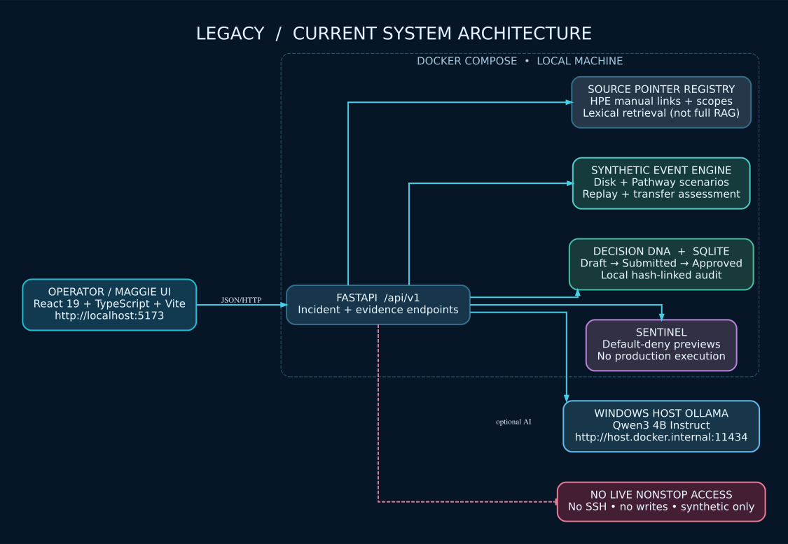
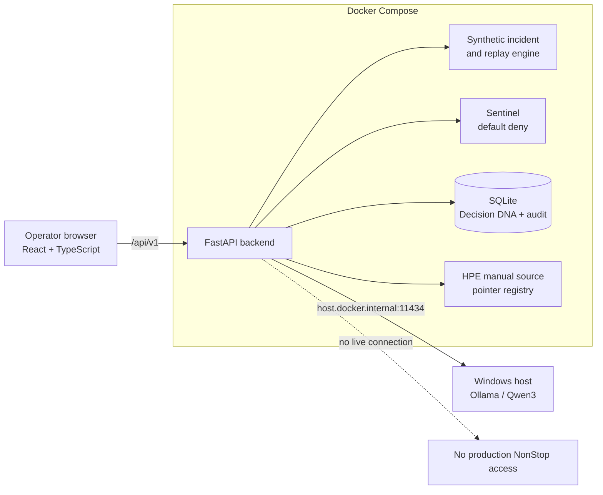
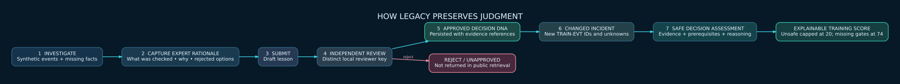
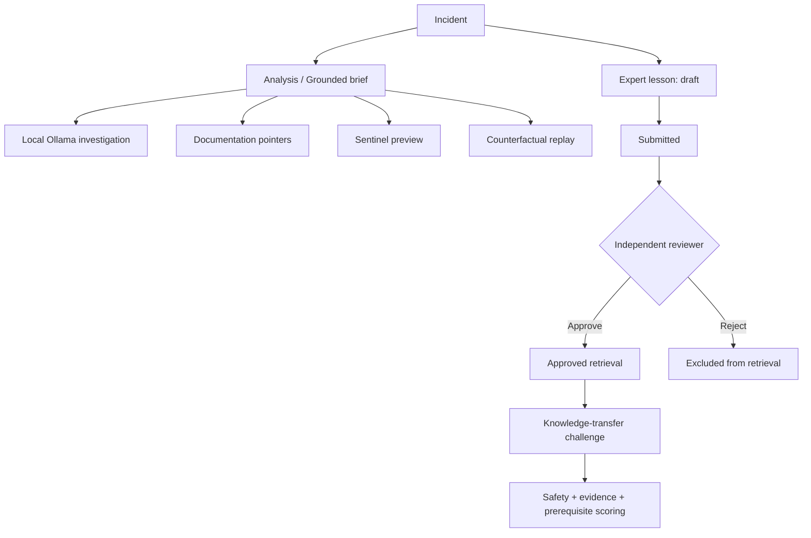

<div align="center">

# △ LEGACY
### An Evidence-First AI Operations Copilot for Mission-Critical Systems

**CAIL • Catalyst 2026 • HPE NonStop-inspired training environment**

    

**[Quick start](#-quick-start-clone--run) · [Maggie's frontend setup](#-maggies-frontend-development-guide) · [Architecture](#-system-architecture) · [API reference](#-api-map) · [Confluence](https://northeastern-team-mx3hi3ad.atlassian.net/wiki/spaces/CAILLEG26)**

</div>

> [!IMPORTANT]
> **Educational prototype only.** This repository does **not** connect to live HPE NonStop systems, execute system commands, or claim production safety. Events (`SIM-EVT-*`), expert lessons created for the demo, and replay outcomes are **synthetic**. HPE manual links are general references—not evidence that an invented event matches an official HPE message.

## 🎯 The hackathon challenge

> How might we use AI to help the next generation of IT operators **understand, monitor, and troubleshoot** mission-critical enterprise systems through **natural language**, while **preserving the expertise** of experienced professionals?

**LEGACY's answer:** A local-first investigation workspace that shows the *evidence* behind a finding, separates an AI explanation from the independent safety policy, and turns reviewed investigation rationale into reusable Decision DNA and a **changed-incident knowledge-transfer challenge**.

| Requirement | Working prototype capability | Important boundary |
|:---|:---|:---|
| Understand | Qwen3 via local Ollama explains synthetic incidents | Generated text remains **unverified** |
| Monitor | Disk-growth / Pathway incidents, metrics, event timeline | Fixtures, **not** live telemetry |
| Troubleshoot | Evidence-linked findings, missing-fact lists, safe previews | No actual command execution |
| Preserve expertise | SQLite Decision DNA: draft → submit → independent review → approved | Demo keys do not establish real-world operator identity |
| Improve judgment | Counterfactual replay + changed-incident assessment | Predetermined scenarios, not real-world prediction |
| Trust and continuity | Default-deny Sentinel, hash-linked local audit, shift briefing | Not hardened RBAC, signed audit, or completed PWA |

## 🧭 System architecture



<details><summary><strong>Open the equivalent editable Mermaid architecture</strong></summary>



</details>

**What's running where?** Docker Compose runs the **frontend (port 5173)** and **FastAPI (port 8000)**. Native **Ollama remains on Windows**; FastAPI calls it over `host.docker.internal:11434`. SQLite lives in Docker's named `legacy_knowledge` volume. Do not remove that volume if you need existing demo lessons.

## 🧠 The feature that makes LEGACY different



1. **Observe** an incident with traceable synthetic event IDs and explicitly missing evidence.
2. **Capture** a lesson: observations, rationale, rejected alternatives, prerequisites and references.
3. **Submit and review** through two distinct locally configured roles. Only *approved* notes are publicly retrievable.
4. **Transfer** that lesson to a **different synthetic case**, rather than repeating the original answer.
5. **Assess** action choice, evidence and prerequisites with a reproducible rubric. Unsafe choices cannot pass; no operational action runs.

The workflow is implemented for **synthetic** cases. It does **not** claim we already captured knowledge from a verified senior HPE operator.

## 🚀 Quick start: clone & run

**For Ritvij, Maggie, and authorized collaborators • Windows 11 / PowerShell**

### Prerequisites

- Git, Docker Desktop **with engine running**, and Windows 11.
- For AI responses: [Ollama](https://ollama.com/download) and the local model `qwen3:4b-instruct` (other features work without it).
- For local frontend editing: Node.js LTS / npm. For local backend tests: Python 3.12.
- **Private repository:** the owner must first invite Maggie at **GitHub repository → Settings → Collaborators → Add people**. She must accept the invitation before `git clone` can access it. No passwords, tokens or `.env` files need to be sent in chat.

**1 — Clone this repository** (in PowerShell):

```powershell
git clone https://github.com/naramritvij/CAIL-LEGACY-NonStop-AI.git
cd CAIL-LEGACY-NonStop-AI
code .
```

**2 — Start the local model** (optional for the read-only UI; recommended for Ask LEGACY):

```powershell
ollama pull qwen3:4b-instruct
# Ollama must be running on the Windows host.
```

**3 — Start the complete app:**

```powershell
docker compose up -d --build
docker compose ps
```

| Open in your browser | Purpose |
|---|---|
| **http://localhost:5173** | React Incident Black Box |
| **http://localhost:8000/docs** | Interactive FastAPI / OpenAPI documentation |
| **http://localhost:8000/api/v1/health** | Backend readiness / synthetic mode |
| **http://localhost:8000/api/v1/incidents/INC-DISK-001/grounded-brief** | Example evidence-linked brief |

Check app logs with `docker compose logs -f backend` and stop the demo with `docker compose down` (this **keeps** the named database volume). **Do not run** `docker compose down -v` unless you intentionally want to erase local demo knowledge.

### Test the backend (Windows)

```powershell
cd backend
py -3.12 -m venv .venv
.\.venv\Scripts\python.exe -m pip install -r requirements-dev.txt
.\.venv\Scripts\python.exe -m pytest -q
cd ..
```

Latest team-verified local baseline: **95 backend tests passed** (17 Oct 2026), six local Ollama investigation calls accepted, and frontend build/safety smokes passed. The **pending backend foundation review branch adds 12 pytest cases** (Legacy Tree plus Incident Workspace), targeting **107 tests**; this new total has not yet been verified on Windows. A Starlette/httpx deprecation warning is currently non-blocking. The local baseline is not a CI guarantee.

## 👩‍💻 Maggie's frontend development guide

> **Team ownership:** Maggie owns the React/TypeScript UI, visual design and frontend integration. Ritvij owns FastAPI, AI, simulator, policies, persistence and the API contracts. Use feature branches and pull requests so both tracks can progress in parallel.

### Option A — Run the entire existing application first (fastest)

After accepting repository access, follow **Quick start** above. Edit `frontend/src/App.tsx` and `frontend/src/styles.css` only after seeing the original UI at `localhost:5173`. Docker rebuild is required to incorporate edits because the current Compose setup does **not** bind-mount frontend source files:

```powershell
docker compose up -d --build frontend
```

### Option B — Recommended for live UI development (hot reload)

This uses the **existing Vite app** on Windows while the backend runs in Docker. No need to create a new React or Next.js project. A separate `vite.local.config.ts` proxies `/api` to the local backend on port 8000.

**Terminal 1**, from the repository root:

```powershell
docker compose up -d --build backend
docker compose stop frontend  # release port 5173 if the Docker frontend was already started
```

**Terminal 2**, from the repository root:

```powershell
cd frontend
npm.cmd install
npm.cmd run dev -- --config vite.local.config.ts
```

Open **http://localhost:5173**. Editing frontend source should now trigger Vite hot reload. The local Vite proxy handles API requests; in React, call **`/api/v1/...`**, *not* `http://backend:8000` (the Docker hostname is invisible to Windows browsers).

To check code quality before sending it to Ritvij:

```powershell
npm.cmd run build
```

> [!NOTE]
> Current UI technology is **React + Vite + TypeScript**, not Next.js. If Maggie wants Next.js, discuss the migration first and create a separate feature branch. Do **not** replace the working frontend unintentionally. Keep all expert and reviewer keys out of browser bundles.

### Suggested Git collaboration (Maggie)

```powershell
git switch main
git pull origin main
git switch -c feat/maggie-frontend
```

After changing files:

```powershell
git status
git add frontend/
git commit -m "feat(frontend): refine LEGACY interface"
git push -u origin feat/maggie-frontend
```

Open a **pull request into `main`**, request Ritvij's review, and coordinate API contract changes before merging. Ritvij should use separate backend branches to avoid collisions.

### Maggie's API handoff checklist

| UI concept | Endpoint to integrate | What to render |
|---|---|---|
| Incident selector | `GET /api/v1/incidents` | Two synthetic cases and metrics |
| Evidence trail | `GET /api/v1/incidents/{id}/grounded-brief` | Claims + `SIM-EVT-*` citations + unknown root cause |
| **Incident Workspace** | `GET /api/v1/incidents/{id}/workspace` | Read-only aggregated evidence, previews, approved knowledge, tree and training links; **no Ollama call** |
| Explain with AI | `POST /api/v1/investigate` | Loading/error state and `generated_unverified` label |
| Sentinel | `POST /api/v1/diagnostics/preview` | Safe preview vs blocked purge |
| Counterfactual | `POST /api/v1/replay` | **Simulated**, not predicted, outcomes |
| Decision DNA | `GET /api/v1/knowledge/lessons` | Approved records only |
| Legacy Tree | `GET /api/v1/knowledge/legacy-tree?incident_id=INC-DISK-001` | Only approved synthetic lesson nodes + revision edges; never fictional reuse counts |
| Knowledge transfer | `GET /api/v1/training/challenges/{lesson_id}` + `POST .../assess` | New-event scenario + rubric; needs approved lesson |
| Shift handover | `GET /api/v1/shift-briefing` | Open incidents and missing evidence |

**Full contracts:** [Backend API overview](docs/BACKEND_API_CONTRACT.md) · [Sprint 2](docs/BACKEND_SPRINT2_API.md) · [Sprint 3](docs/BACKEND_SPRINT3_API.md) · [Maggie's integration handoff](docs/SPRINT3_HANDOFF.md).

**Current cross-team MVP plan:** [Complete incident → Decision DNA → apprentice transfer handoff](docs/END_TO_END_MVP_HANDOFF.md) documents every existing endpoint, safety/error state, the synthetic demo walkthrough, and what's still Maggie's frontend work. Backend contract integration tests live in `backend/tests/test_demo_journey.py` (included in full pytest). This backend handoff does **not** implement Maggie's screens.

## 🧩 Repository map

```text
CAIL-LEGACY-NonStop-AI/
├── backend/
│   ├── app/                   # FastAPI; evidence; safety; AI; knowledge; training
│   ├── tests/                 # pytest API/security/knowledge tests
│   ├── Dockerfile
│   └── requirements*.txt
├── frontend/
│   ├── src/                   # Maggie: React views/styles
│   ├── vite.config.ts         # Docker/Vite frontend proxy
│   └── vite.local.config.ts   # Windows host development proxy
├── docs/
│   ├── assets/                # Editable SVG architectural visuals
│   ├── BACKEND_API_CONTRACT.md
│   ├── BACKEND_SPRINT2_API.md
│   └── BACKEND_SPRINT3_API.md
├── scripts/                   # Optional explicitly synthetic knowledge demo seed
├── compose.yaml
└── .env.example               # Template only — NEVER commit .env
```

## 🔌 API map



Interactive schema is always available at **[FastAPI `/docs`](http://localhost:8000/docs)** when the local backend is running. Public endpoints serve simulated training information. The protected write/review endpoints require **distinct local demo secrets**; they are **not production login, SSO or RBAC**. For a safe optional demonstration, see [`scripts/seed_demo_knowledge.ps1`](scripts/seed_demo_knowledge.ps1); run it only with `-ConfirmSynthetic` from your own computer and never share `.env` contents.

## 🔐 Reliability, cost and privacy

| Item | Current position |
|---|---|
| Paid APIs | None required for local prototype |
| LLM "training" | **No fine-tuning** — local inference + approved-note lexical retrieval |
| HPE source material | Curated official document *pointers*, not full-text RAG or an HPE-certified knowledge base |
| Command safety | Display-only reference templates and a deterministic default-deny simulator |
| Audit | Local hash-linked SQLite records; **not tamper-proof** against privileged DB modifications |
| Security | Private repo, local ports, demo role keys. Authentication, rate limits and threat testing still needed for deployment |
| Mobile | Responsive browser UI foundation; dedicated Android app and installable PWA not implemented |

**Please do not:** commit `.env`, ship real customer logs, hardcode reviewer keys in React, run commands from model prose, treat training scores as verified employee competence, or describe synthetic event IDs as actual HPE codes.

## 🧯 Troubleshooting

| Problem | What to check |
|---|---|
| Git clone returns 404 | Private repo: ask Ritvij for collaborator invitation, accept it and sign in through Git/GitHub |
| `docker compose` cannot connect | Open Docker Desktop and wait for *Engine running* |
| Frontend cannot load incidents | Check `docker compose ps` and `http://localhost:8000/api/v1/health`; inspect backend logs |
| `model_unavailable` | Ollama running on host? `ollama list`; check `qwen3:4b-instruct` name, backend logs, `host.docker.internal:11434` |
| PowerShell blocks `npm.ps1` | Run `npm.cmd` / `npx.cmd` instead; no global policy change needed |
| Port 5173 in use | Stop Docker frontend before local Vite dev; don't run both on same port |
| No approved lesson / transfer challenge 404 | Review workflow hasn't created an approved lesson; do not fake a verified operator |
| Role-protected endpoints return 503 | Create separate local credentials in **untracked** `.env`; don't send them to teammates |

## 📚 Collaboration and project records

- **[Confluence project space](https://northeastern-team-mx3hi3ad.atlassian.net/wiki/spaces/CAILLEG26)** — architecture, sprint history, evaluation and meeting rituals.
- **[GitHub issues](https://github.com/naramritvij/CAIL-LEGACY-NonStop-AI/issues)** — backlog and acceptance checks.
- **[Project charter](docs/REQUIREMENTS.md)** · **[Security boundaries](docs/SECURITY.md)** · **[Detailed architecture](docs/ARCHITECTURE.md)**

<div align="center">

**LEGACY = People + Knowledge + Safe Operations.**

*Understand what happened. Show the evidence. Preserve the reasoning.*

</div>

### Optional locally reviewed excerpt corpus (Sprint 4)

The backend now supports **user-supplied, authorized** documentation excerpts with expert submission, independent reviewer approval, SHA-256 chunk citations and an explicit NonStop-release search filter. Nothing is downloaded from HPE automatically; an official-looking URL is not proof that pasted text is genuine. This is an **offline lexical chunk index, not full vector/semantic RAG**. With no approved excerpts, searches correctly return `no_match`.

[Read the five new endpoints, ingestion rules and security limits](docs/BACKEND_SPRINT4_CORPUS.md). Existing Incident Black Box and Maggie's frontend routes are unchanged.

### Sprint 5 — Citation-bounded local AI investigations

Use `POST /api/v1/investigate/grounded` to request a structured local Qwen3 explanation of the **synthetic** incident, optionally augmented by release-matched, locally approved document chunks. Every generated claim must identify a registered `SIM-EVT-*` or `DOC-*` citation; invented IDs or malformed model JSON cause the claim output to be suppressed. **Matching an ID is not verifying the claim's truth or the document's authenticity.** The AI cannot execute or approve commands, and the existing frontend is unchanged. See [API contract and verification steps](docs/BACKEND_SPRINT5_GROUNDED_AI.md).
