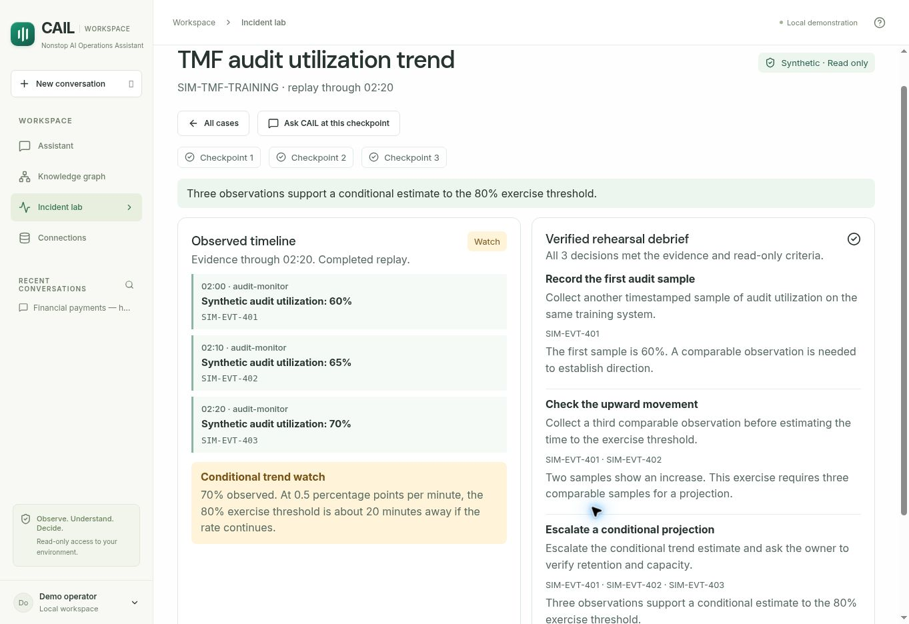
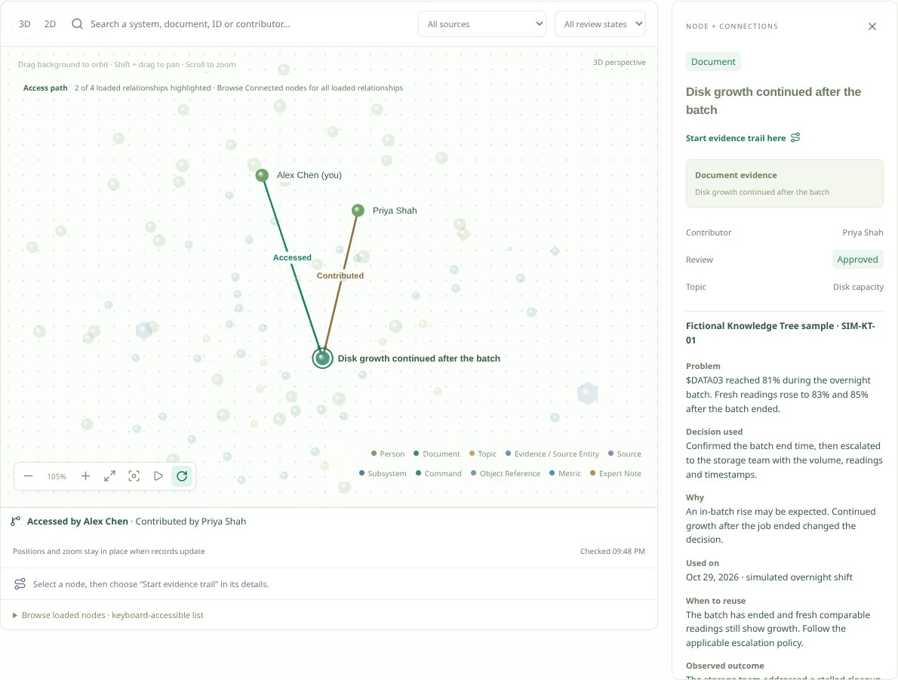

# CAIL / NonStop AI Operations Assistant

CAIL helps an operator investigate a NonStop incident, keep the supporting evidence with the decision, and pass reviewed guidance to the next operator. The application has one assistant, a staged incident lab, an interactive knowledge graph, and a page for authorized read-only source connections.

The main portal on **5173** includes a fictional Knowledge Tree walkthrough with 40 named Senior Contributors and 80 switchable junior operators. The standalone reviewer demo also includes four fictional incident rehearsals. The seeded graph, incident lab, and handoff work without an Ollama model or a customer account.

*Completed TMF rehearsal captured from the app. The readings and 80% threshold belong to this training case.*

## Open the Knowledge Tree on the main portal

From your checkout, start the workspace with [Docker Compose](#run-the-regular-workspace) or run the local launcher. For a first local run, install Python 3.12 or later and Node.js 22.12 or later, then install the Python and frontend dependencies.

~~~powershell
python -m pip install -r backend/requirements.txt
npm.cmd --prefix frontend ci
npm.cmd run dev -- --host 127.0.0.1
~~~

On macOS and Linux, use `npm` in place of `npm.cmd`. Open **Knowledge graph → Fictional walkthrough** on the main portal. Use **Workspace graph** to return to your own documents and contributions. The practice tab has its own operator session and SQLite database. [Open the walkthrough on 5173](http://localhost:5173/#/graph/practice)

## Run the reviewer demo

Clone the repository and choose either launch option. Both seed the fictional people, knowledge, completed handoff, and practice request. After the launcher reports that the seed is complete, open the URL it prints and follow the Knowledge Tree walkthrough below.

~~~powershell
git clone https://github.com/naramritvij/CAIL-LEGACY-NonStop-AI.git
cd CAIL-LEGACY-NonStop-AI
~~~

### Run locally with Python and Node.js

Install Python 3.12 or later and Node.js 22.12 or later. Run these commands in PowerShell.

~~~powershell
python -m venv .venv
.\.venv\Scripts\python.exe -m pip install -r backend/requirements.txt
npm.cmd --prefix frontend ci
.\.venv\Scripts\python.exe scripts/start_transfer_demo.py --local
~~~

On macOS and Linux, use `npm` and your virtual environment’s `python`. The local demo uses loopback and saves its own database under `data/transfer-demo/5180/`. Keep the terminal open while using the demo.

### Run with Docker Compose

Install Python 3.12 or later and Docker with Compose v2. On Windows, start Docker Desktop with the Linux engine before running the commands.

~~~powershell
docker version
docker compose version
python scripts/start_transfer_demo.py
~~~

| Address | Use it for | Storage |
| --- | --- | --- |
| [127.0.0.1:5180](http://127.0.0.1:5180/#/graph) | Self-guided Knowledge Tree, fictional operator switching, incident rehearsals, and verified handoffs | Separate local SQLite database or `cail-transfer-demo` Docker volume |
| [localhost:5173](http://localhost:5173/#/assistant) | Main workspace, saved conversations and documents, local Ollama, authorized sources, and the fictional Knowledge Tree tab | Separate workspace and practice databases |

### Follow a senior’s decision in the Knowledge Tree

1. Open the **Fictional walkthrough** tab on the main portal or the standalone reviewer graph. A fresh practice session starts as **Alex Chen**, one of the 80 fictional junior operators. Click **Open Priya’s case**. Read the problem, decision, reasoning, when she used it, when it applies and what happened in the fictional case. [Main portal](http://localhost:5173/#/graph/practice) · [Standalone reviewer graph](http://localhost:5180/#/graph)
2. Watch the 3D graph for about five seconds. Alex’s node enters the scene and an **Accessed** link draws to the exact guidance he opened. The graph then highlights the existing contribution from **Priya Shah**. The guidance opens immediately. A reduced-motion setting shows the saved path directly.
3. Click **Switch demo operator**, choose **Maya Patel** or any other named junior, and click **Switch junior operator**. Open Priya’s case again. Maya gets her own **Accessed** link. Switch back to Alex and reopen it to see his existing link. Reload the page to verify the recorded access persists. Access records describe what someone opened.
4. Open **Miguel’s case**. Both cases begin at 81% in this exercise. Priya escalated when fresh readings kept rising after the batch ended. Miguel monitored when fresh readings fell. Compare **When to reuse** and the outcomes to see what changed the decision.
5. Click **Browse Senior Contributors**, search for **Noor Hassan**, then open **Choose a comparable disk baseline** from her profile. It’s a proposed reference note you can read directly. The directory also supports opening and requesting guidance from a specific contributor.

### Reproduce the financial incident

1. Open **Incident lab → Financial payments — hardware capacity reduction → Start rehearsal**. Verify the first checkpoint shows the **01:08** hardware warning on the training system.
2. Click **Ask CAIL at this checkpoint**. Ask `Show the observed timeline.` The reply cites **SIM-EVT-301**. Then ask `Quote the payment result from SIM-EVT-304.` The reply says the requested observation is outside the checkpoint.
3. Return to **Incident lab** and reopen the financial case under **Saved rehearsals**. Try **Restart the affected service immediately** with the first record selected. **Assess decision** blocks the action and keeps you at the same checkpoint.
4. Complete the three decisions using the table below. Select each evidence record in the timeline and choose the action before clicking **Assess decision**.
5. Confirm **Verified rehearsal debrief** lists all three decisions and their evidence IDs. Click **Download debrief** to get the JSON record. It contains the observed timeline, unresolved questions, the next authorized check, and the case version hash.
6. Reopen the original checkpoint chat from **Recent conversations**. Asking for **SIM-EVT-304** there still withholds the record. A new chat opened at the final checkpoint can cite it.

| Checkpoint | Supporting records | Decision to assess |
| --- | --- | --- |
| Scope the capacity warning | `SIM-EVT-301` | Confirm the affected node and compare available capacity with other nodes. |
| Correlate without assuming cause | `SIM-EVT-301`, `SIM-EVT-303` | Record the order of the hardware, CPU and service symptoms and check for shared dependencies. |
| Hand off payment impact | `SIM-EVT-304`, `SIM-EVT-305` | Escalate payment impact and the worker exit with timestamps and request an authorized dependency check. |

The final records show a fictional 980 ms payment response and 89% success rate, followed by a worker exit. The debrief preserves that order and keeps root cause and recovery unresolved.

### Try the other cases

| Case | What to verify |
| --- | --- |
| **$DATA03 capacity increasing** | Use the baseline and later threshold observation for the handoff. Cleanup depends on verified ownership, retention policy, and dependencies. |
| **Pathway service degradation** | Follow the first latency symptom through an unresponsive service instance and a later downstream delay. Separate observed symptoms from an inferred dependency cause. |
| **TMF audit utilization trend** | At checkpoint two, choose to collect a third comparable sample. At checkpoint three, 60%, 65%, and 70% produce a **20-minute conditional estimate** to the fictional 80% threshold at 0.5 percentage points per minute. |
| **Financial payments** | Demonstrate cross-source chronology, a blocked restart, an evidence cutoff, and a handoff with the service impact and unanswered questions. |

Each rehearsal is saved under its operator. The final debrief records what the operator selected and the evidence accepted at each checkpoint. **Synthetic · Read only** stays visible throughout. Scoped rehearsal answers use the saved evidence directly. General conversations use the configured local model.

## Demonstrate knowledge transfer

Open the **Fictional walkthrough** and select **People & handoffs**. The completed request has a **Learning verified** badge. **View learning receipt** shows the assessor, four criteria, citations and guidance version. To create a second receipt, use the practice request about an unclear TMF observation. [Open the walkthrough](http://localhost:5173/#/graph/practice)

| Who | What to click | What to verify |
| --- | --- | --- |
| **Priya Shah · Senior Contributor** | **Switch demo role → Priya Shah → People & handoffs → Write guidance** on the practice request | Enter a title such as `Evidence before TMF escalation`. In **Find concepts and source citations**, search `TMFCOM STATUS TMF`, select that command, and cite the approved **Synthetic TMF training source** passage. Choose **Sign and add guidance → Submit for review**. |
| **Jordan Lee · Independent Reviewer** | **People & handoffs → Independent review → Evidence before TMF escalation** | Open the cited passage. Enter **Review reasoning** after checking the excerpt and click **Approve**. |
| **Alex Chen · Junior Operator** | Open the same practice request and click **Explain the guidance** | Explain the decision, exact supporting evidence, limitations, and the next authorized read or escalation. Click **Submit explanation for review**. |
| **Jordan Lee · Independent Reviewer** | **People & handoffs → Independent review → Open explanation reviews** | Check the explanation against the guidance, confirm all four criteria, record reasoning, and approve. |
| **Alex Chen · Junior Operator** | **View learning receipt** on the practice request | The new receipt names `Evidence before TMF escalation`. It contains the reviewer, date, four criteria, citations, and the guidance hash. |

For this fictional TMF exercise, the guidance can describe confirming the system identity and observation time, comparing a fresh authorized reading, and escalating conflicting or stale evidence. The learner should explain why those checks matter and why one observation leaves the cause uncertain.

The **Contributors** directory shows visible documents, approved guidance, and your recorded document access. Use **Add a contributor** as **Priya Shah** to exercise manager enrollment. In a regular workspace, the configured manager can issue, rotate, or revoke a member key. The handoff is visible to its participants, and the reviewer sees the submitted guidance and explanation through the review queues. Approval of a superseding source sends dependent guidance back for review.

## Explore the knowledge graph

1. Open **Knowledge graph → Knowledge map → 3D**. Select a person, document, concept, or observation. The inspector shows its stored relationships and source details.
2. Choose **Add knowledge**, give a small Markdown or PDF file a title, and upload it. Watch the new node enter from the side and connect to its contributor. The document appears as **Draft** in the inspector. Reload to verify the node and link persisted.
3. Select a document or concept and use **Start evidence trail here**. Select a connected node and trace the path. **Play 3D trail** follows the stored edges. Clear the selection and move your pointer off the canvas to see the idle orbit. The circular-arrow control pauses it.
4. To build a larger graph with public evidence, use **Add knowledge → HPE references** and import the **HPE NonStop TACL Reference Manual**. It downloads from HPE, extracts passages and literal references, and records source metadata. Select **Manual passages** to expose those passage nodes. The import needs outbound access to the publisher.
5. To connect a new document to an existing source entity, select it and use **Attach knowledge**. **Import dataset** accepts a separate topology JSON or CSV export. The link types distinguish text references from source-provided topology.

Standard files are up to 4 MB and include PDF, DOCX, TXT, Markdown, CSV and LOG. **Reference manual** supports larger manuals up to 32 MiB and 1,000 PDF pages. Scanned documents need extracted text or OCR. Drafts are private to their owner, submitted items are visible to independent reviewers, and current approved knowledge is eligible for assistant retrieval. [Graph formats and bounds](docs/SCALABLE_GRAPH.md)

## Run the regular workspace

In the same checkout, run:

~~~powershell
docker compose up -d --build
docker compose ps
~~~

Open [the regular workspace](http://localhost:5173/#/assistant). The backend health endpoint is [localhost:8000/api/v1/health](http://localhost:8000/api/v1/health) and should return `"status":"ok"`. To rebuild an existing checkout, use `git switch main`, `git pull --ff-only origin main`, then the same Compose command. Workspace and practice records use separate Docker volumes.

### Test conversation memory with Ollama

Start Ollama on your computer and install the configured model. With the desktop service already running, use:

~~~powershell
ollama pull qwen3:4b-instruct
ollama list
docker compose exec backend python -m app.conversation_smoke
~~~

The smoke test creates a conversation, saves a fresh checklist name, asks an unrelated API question, then verifies recall and all six saved messages. To repeat in the browser, ask CAIL to remember a unique checklist name, ask what an API is, reload the conversation, and ask for the checklist name. Check **Conversation memory** for six saved turns and earlier context supplied to the answer.

On Docker Desktop, the main backend uses `http://host.docker.internal:11434`. If Docker cannot reach the host model, check that Ollama is running and the configured model appears in `ollama list`. The [local development route](#local-development) runs the backend beside Ollama on the host.

### Configure separate operators

The regular workspace initially has one **Local operator** identity. To run actual team handoffs there, set `CAIL_WORKSPACE_LOCAL_DEMO=false` and configure `CAIL_WORKSPACE_USERS` in a private local `.env` using the format in [`.env.example`](.env.example). Give each operator a stable ID, display name and unique key of at least 32 characters. Set `can_review` for an independent reviewer and `can_manage_members` for the manager. Grant `can_read_live` only to authorized readers.

Recreate the backend with `docker compose up -d --build backend`, then sign in from **Connections → Operator sign-in / Switch operator**. The contribution counts and document visibility follow the signed-in identity. Workspace access keys provide local account separation. Deployment-wide identity integration remains a pilot decision.

## Real source access

The app has read-only source paths for **IR Prognosis**, **HPE ASAP** and **MOMI**. The browser receives scoped observations through the backend. Set the authorized connection and expected system ID in the local server configuration.

| Source | Supported paths | Scope setting |
| --- | --- | --- |
| **IR Prognosis** | Admin-provisioned HTTPS dataset and Basic authentication with mapped fields, or an approved normalized gateway | `CAIL_PROGNOSIS_SYSTEM_ID` |
| **HPE ASAP** | Authorized Consumer/query bridge through the normalized HTTPS gateway | `CAIL_ASAP_SYSTEM_ID` |
| **MOMI** | Read-only alarm-export folder, explicit export import, or an approved gateway | `CAIL_MOMI_SYSTEM_ID` |

1. Get the authorized endpoint or export, the expected system ID, and read permission from the environment owner. Follow the [native source setup](docs/NATIVE_SOURCE_SETUP.md) and [gateway contract](docs/LIVE_SOURCE_GATEWAY.md).
2. Set `CAIL_LIVE_ENABLED=true`, configure the allowed host list for HTTPS, and grant `can_read_live` to the intended operator. Add any optional topology URLs using the [topology setup](docs/SCALABLE_GRAPH.md#connect-actual-prognosis-asap-and-momi-topology).
3. Recreate the backend. Sign in as the authorized operator. In **Connections**, run the source check and inspect the system ID, last observation time, and health. Refresh authorized topology in **Knowledge graph** when a topology path is configured.
4. Run the receipt command below. It checks the configured observation and topology paths, system identity, freshness, and hashes. Use `--source prognosis`, `--source asap` or `--source momi` for a single source. Add `--operator <id>` when more than one configured account can read live data.

~~~powershell
docker compose exec backend python -m app.source_acceptance
~~~

Controlled TLS and MOMI export checks have passed. The private CAIL pilot requires a receipt from its authorized environment. Missing, stale, malformed and wrong-system data remain unknown. Source reads do not execute NonStop commands.

## Reproduce the evaluation

From the repo root on Windows:

~~~powershell
python -m venv .venv
.\.venv\Scripts\python.exe -m pip install -r backend/requirements-dev.txt
.\.venv\Scripts\python.exe scripts/evaluate_workspace.py --report eval/results.local.json
~~~

On macOS or Linux:

~~~bash
python3 -m venv .venv
.venv/bin/python -m pip install -r backend/requirements-dev.txt
.venv/bin/python scripts/evaluate_workspace.py --report eval/results.local.json
~~~

Expect **120/120 offline answer cases passed** and four debriefs recovered after an API restart. The runner starts an isolated HTTP backend and temporary database. It seeds synthetic reviewed sources, checks all 12 rehearsal decisions and their evidence boundaries, and scores each answer against expected behavior, required facts, allowed citations and read-only flags. GitHub Actions runs the same suite and retains the per-case report.

The separate **100-question model suite** exercises the normal local Ollama assistant. It covers reviewed guidance, saved user and assistant turns, general questions, observation reading, chronology, and operator judgment. Start Ollama with `qwen3:4b-instruct`, then run:

~~~powershell
.\.venv\Scripts\python.exe scripts/evaluate_workspace.py --suite model --case qwen-01 --case qwen-09 --case qwen-17 --report eval/model-smoke.local.json
.\.venv\Scripts\python.exe scripts/evaluate_workspace.py --suite model --report eval/model-results.local.json
~~~

On macOS or Linux, use `.venv/bin/python` for the same commands. The full run makes multiple requests per multi-turn case. The report records the model digest, per-case answers, citations, and latency so a reviewer can inspect the output. For the hosted CPU run, open **Actions → CAIL local model evaluation**. Each runner starts its own loopback Ollama service. The workflow publishes the measured score and reports for the exact commit it evaluated. [Question sets and scoring](eval/README.md)

| Check | Verified evidence |
| --- | --- |
| Offline answer evaluation | **120/120** on an isolated local HTTP run. Answer request p50 **4.0 ms**, p95 **7.4 ms** in that run. The timing covers bounded replay and reviewed answer handling. |
| Incident walkthrough | Financial and TMF walkthroughs exercised in the browser. HTTP acceptance covers all four cases, access isolation, action blocking, evidence cutoff, retries, and restart persistence. |
| Knowledge transfer | Separate expert, reviewer, and learner sessions completed the browser workflow and produced a version-bound receipt. |
| Conversation memory | Owner's Windows run recalled the checklist name after an unrelated question and saved all six messages. |
| Source transport | Controlled Prognosis and ASAP HTTPS reads and read-only MOMI export with scope, freshness, and blocked redirect checks. |
| Code regression | Backend suite, frontend contracts, dense graph readability and production frontend build. See the repository's **Actions → CAIL integration quality gates** run for the commit you are reviewing. |

### Run the regression checks

Run from the repo root with the virtual environment activated and the frontend dependencies installed.

~~~bash
cd backend
python -m pytest -q
cd ..
python scripts/verify_graph_http.py
python scripts/verify_knowledge_transfer.py
python scripts/verify_source_transport.py
npm --prefix frontend run test:contract
npm --prefix frontend run test:graph
npm --prefix frontend run build
~~~

`verify_source_transport.py` needs OpenSSL for its local test certificate. The same checks run on Linux in **CAIL integration quality gates**. For graph and retrieval timings on the fixed fixture, run `python scripts/benchmark_workspace.py`. To compare two revisions on the same machine, add `--baseline <path-to-other-checkout>`.

## Shut down or troubleshoot

- Press **Ctrl+C** to stop the local reviewer demo. For Docker, run `docker compose -p cail-transfer-demo -f compose.transfer-demo.yaml down`. Stop the regular Compose workspace with `docker compose down`.
- If Docker Desktop or its WSL engine fails to start, use the [local reviewer launcher](#run-locally-with-python-and-nodejs).
- If port **5180** is in use, add `--port 5181` to your launch command and open the URL it prints. The local launcher keeps a separate database for each frontend port.
- Open **Knowledge graph → Fictional walkthrough** on **5173** to see the seeded guidance requests and named operator switcher.
- If the normal frontend opens before the API is ready, run `docker compose ps`, check `docker compose logs --tail=60 backend frontend`, and refresh when the health endpoint responds.
- If the graph shows few nodes, select **Knowledge map** or **All relationships**, check the source and review filters, and enable **Manual passages** when inspecting imported evidence.

### Local development

Install Python 3.12+ and Node.js 22.12+. Use the virtual environment and backend dependencies above, then run:

~~~bash
npm --prefix frontend ci
npm run dev
~~~

The launcher starts Vite and FastAPI locally. It uses Ollama at `http://localhost:11434` by default. Pass `--host 127.0.0.1` to bind Vite to loopback, or `--port` to choose a different frontend port. The older public funnel demonstration is a separate deployment.

## Technical references

- [Workspace architecture and agent contracts](docs/AGENT_WORKSPACE.md)
- [Semantic graph, learning receipts and evidence trails](docs/SEMANTIC_KNOWLEDGE_GRAPH.md)
- [HPE references, direct Prognosis and MOMI export setup](docs/NATIVE_SOURCE_SETUP.md)
- [Historical sponsor acceptance and earlier endpoints](docs/SPONSOR_MISSION_ACCEPTANCE.md)
